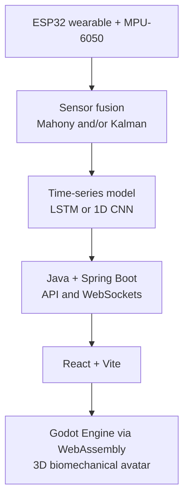

# 🦾 Biomech Digital Twin

A low-cost biomechanical digital twin for motor telerehabilitation.

Biomech Digital Twin is a proposed system that combines wearable sensors, time-series deep learning, and real-time 3D visualization to support remote movement monitoring. It aims to provide an accessible alternative to expensive optical motion-capture systems and help identify potential postural compensations.

Project status: Research and prototyping proposal. The architecture and technologies below are planned; implementation and performance still need to be validated.

## Objectives

- Capture movement data using wearable ESP32 devices and MPU-6050 inertial sensors.
- Estimate spatial orientation using sensor-fusion filters.
- Explore time-series deep-learning models to classify movement quality and identify potential postural compensations.
- Stream data through a Spring Boot backend using WebSockets.
- Visualize movement in a browser-based 3D avatar using Godot Engine and WebAssembly.

## Proposed architecture

The final location of AI inference has not yet been determined. The model may run on the server or be quantized for edge deployment.

## Planned technology stack

| Component | Technologies |
|---|---|
| Wearable hardware and firmware | ESP32, MPU-6050, Li-Po battery, C/C++ |
| Inertial processing | Mahony and/or Kalman filter, quaternion orientation |
| Deep learning | Python, TensorFlow/Keras, LSTM or 1D CNN |
| Backend and communication | Java, Spring Boot, WebSockets |
| Web interface | React, Vite |
| 3D visualization | Godot Engine, WebAssembly (WASM) |

## Estimated budget

The preliminary proposal estimates **R$295 for wearable hardware** and approximately **R$500 for six months of VPS hosting**, keeping the overall prototype budget below R$1,000. These are planning estimates, not current quotes.

## Scope

The project aims to support remote biomechanical monitoring; it is not intended to replace assessment by a qualified healthcare professional. Drift mitigation, movement classification, and 3D motion reproduction must be evaluated through testing. Clinical validation has not yet been established.

Research project on IoT, time-series artificial intelligence, and 3D visualization for motor telerehabilitation.
